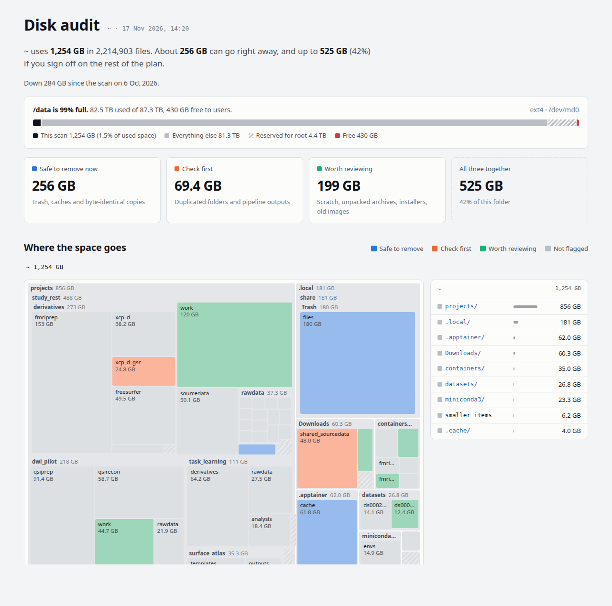
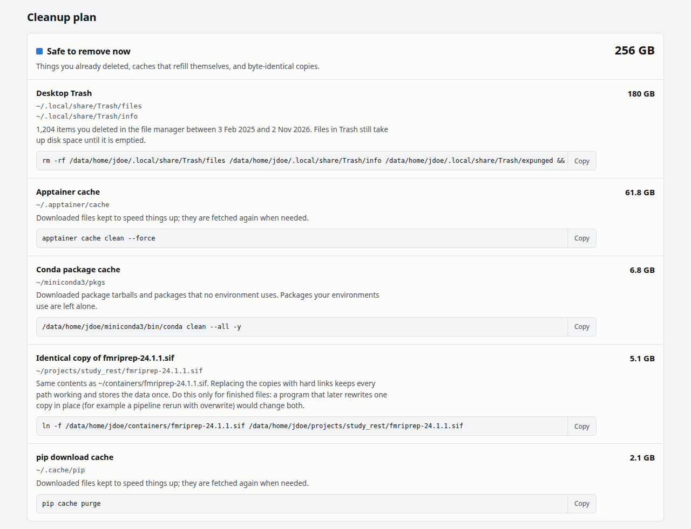

# diskaudit

See where the space on a Linux server goes, and what you can safely delete.

`diskaudit` scans a folder (your home folder by default), prints a summary, and writes a
self-contained HTML report:

- a **treemap** of the folder, in the style of WinDirStat, with every tile colored by whether it
  can go, and a folder table that follows you as you click into folders;
- a **cleanup plan** in three tiers, each item with the space it would actually free and the
  command to run, ready to copy;
- disk usage by file type, the container images it found, the largest files, and a
  **history** of earlier scans, so you can see how much you freed.

It is built for shared research servers, where home folders fill up with pipeline scratch,
container images, unpacked archives and copies of datasets, but it works on any Linux machine.
It needs only Python 3.9 or newer, with no other packages.

**It never deletes anything.** The report lists commands; you decide what to run.





<sub>Screenshots of a report rendered from demo data with `docs/make_demo_report.py`.</sub>

## Install

For yourself (no admin rights needed):

```bash
git clone https://github.com/alirzar/diskaudit.git
cd diskaudit
./install.sh
```

This puts `diskaudit` in `~/.local/bin` and adds **Disk Audit** to your desktop's
applications menu.

Other ways to install:

| How | Command |
|---|---|
| For every user on the machine (needs sudo) | `sudo ./install.sh --system` |
| Into a shared lab folder | `./install.sh --prefix /path/to/lab/software` |
| With pipx | `pipx install git+https://github.com/alirzar/diskaudit.git` |
| Without installing | `python3 src/diskaudit.py` |

To install a specific release instead of the latest code, clone with `--branch v1.0.0`, or use
`pipx install git+https://github.com/alirzar/diskaudit.git@v1.0.0`. Releases are listed on the
[releases page](https://github.com/alirzar/diskaudit/releases).

To update, run `git pull` and then `./install.sh` again. To remove it, run
`./install.sh --uninstall`, adding the same `--system` or `--prefix` you installed with.

## Use

```bash
diskaudit                      # scan your home folder and open the report
diskaudit ~/projects           # scan another folder
diskaudit --no-open            # summary only, e.g. over SSH; the report is still written
diskaudit --quick              # skip the byte-for-byte check of duplicate files
```

| Option | What it does |
|---|---|
| `-o DIR`, `--out-dir DIR` | Where to write the report (default `~/disk-audit`) |
| `--quick` | Match duplicate files by size and first and last megabyte only |
| `--no-open` | Don't open the report in a browser |
| `-j N`, `--threads N` | Parallel scan threads (default 8) |

A home folder with 3 million files and 1 TB takes about two minutes on a RAID volume. The
first run takes longer when there are many large duplicate candidates, because each one is
read in full once. Their checksums are cached, so later runs only re-read new or changed files.

## What it suggests

| Tier | What lands here |
|---|---|
| **Safe to remove** | The desktop Trash. Caches that refill themselves (Apptainer/Singularity, conda packages no environment uses, pip, npm, Go, browser caches, desktop search index). A single file that is byte-identical to another. |
| **Check first** | Folders that are copies of other folders. Identical files shared between pipeline output folders, which can be replaced with hard links. A Trash holding items deleted from outside your home folder, such as a shared raw-data area. |
| **Worth reviewing** | Pipeline (Nipype) working directories and old scratch folders. Archives whose contents are already unpacked beside them. Installers in Downloads. Older versions of a container image you also have in a newer version. |

## How it measures

- Sizes are disk usage, like `du -x`. It stays on one filesystem, and a hard-linked file
  counts once.
- Each suggestion's size is what deleting it would actually free. Data that is hard-linked
  from somewhere else isn't counted.
- Duplicate files are compared byte for byte (BLAKE2 checksums, cached in
  `~/.local/share/diskaudit/hashes.json`).
- Duplicate folders are matched by their complete list of file names and sizes. Their
  contents aren't compared, which is why they are in the "check first" tier.
- Installed software (any folder with `bin/` next to `lib/`, `share/`, or MATLAB's `toolbox/`
  and `sys/`) is never suggested for cleanup, even when two versions share identical files.
- For the Trash, it reads where each item was deleted from. It warns when items came from
  outside your home folder, so you can check that data still exists elsewhere.
- On ext4 volumes, the report notes how much space is reserved for root and what lowering
  the reserve would make usable.

## Files it writes

| Path | Contents |
|---|---|
| `~/disk-audit/diskaudit_<folder>_<date>.html` | The reports. Each one is a single file you can open anywhere. |
| `~/.local/share/diskaudit/history.jsonl` | One line per scan: total size and free space, for the history table |
| `~/.local/share/diskaudit/hashes.json` | Checksums of large duplicate candidates |

## Similar tools

[QDirStat](https://github.com/shundhammer/qdirstat), Baobab (GNOME Disk Usage Analyzer),
Filelight, [ncdu](https://dev.yorhel.nl/ncdu) and [gdu](https://github.com/dundee/gdu) show
where space goes, and do it well. diskaudit adds the second half: which of it is safe to
delete, how much that frees, and the command to do it.

## Development

```bash
python3 -m unittest discover -s tests -v
```

The whole program is one file, `src/diskaudit.py`, using only the standard library. The
report's HTML, CSS and JavaScript are embedded in it, so the report works offline.

`python3 docs/make_demo_report.py` renders a report from made-up demo data into
`docs/demo-report.html`, which is how the screenshots above were made.

## License

MIT. See [LICENSE](LICENSE).
